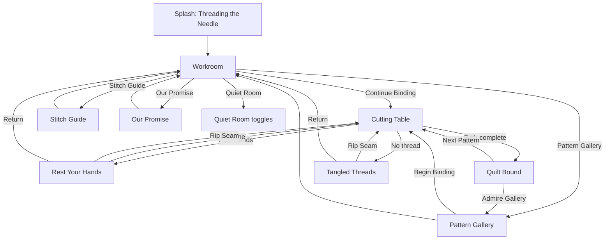

# Patchwork Path — Game Design Document

## Core concept

**Patchwork Path** is a cozy grid puzzle set in a grandmother's quilt workroom. Each level is an unfinished quilt top laid on a cutting table. The player selects fabric patch shapes from a tray, rotates them, and places them on empty grid cells to stitch a continuous path from the **Thread Spool** (start) to the **Thimble** (finish). Some cells are blocked by batting, and some patches are already sewn in place. When the path connects, the quilt is bound and hung in the **Pattern Gallery**.

The game is offline, touch-only, and safe for all ages.

---

## Gameplay loop

1. Open the **Workroom** and choose a pattern from the **Pattern Gallery** (or continue the next unbound quilt).
2. Enter the **Cutting Table** — the quilt grid fills the center of the screen; available patches sit in a fabric tray below.
3. Tap a patch in the tray to select it; tap again to **turn** it (90° clockwise).
4. Tap an empty grid cell to **place** the patch (anchor cell = top-left of the shape). Invalid placement shakes gently and returns the patch to the tray.
5. Each placement uses one **thread length** (move). When the spool connects to the thimble through placed and fixed patches, the level is **bound**.
6. Earn 1–3 **binding stars** based on efficiency and optional pattern goals.
7. Return to the gallery; the next pattern unlocks. Repeat.

There is no time pressure in early levels; later levels add tighter thread limits and pattern goals.

---

## How it works (player-facing)

### The grid

- A square or rectangular **quilt grid** (5×5 up to 8×8 at hardest levels).
- **Empty cells** accept patch pieces.
- **Batting blocks** (padded squares) cannot be covered.
- **Fixed patches** are pre-sewn; they count toward the path but cannot be moved.
- **Thread Spool** marks the start; **Thimble** marks the finish. Both are single cells.

### Patch shapes

Three shapes in v1, each defined as a set of cells relative to an anchor:

| Shape | Cells (relative) | Theme name |
|-------|------------------|------------|
| Straight strip | 3 in a row | **Rail Patch** |
| L-corner | 3 cells forming an L | **Corner Patch** |
| 2×2 square | 4 cells | **Block Patch** |

Patches can be rotated in 90° steps. Colors are drawn in code (calico palette per level) and may matter for pattern goals.

### Path rule

A level is won when there is a **continuous orthogonal path** (up/down/left/right, no diagonals) of patch cells from the Thread Spool cell to the Thimble cell. Fixed patches and player-placed patches both count. Empty cells and batting do not count.

### Moves (thread length)

Each successful placement consumes 1 thread length. Removing a placed patch (long-press or undo button) refunds 1 thread length. If thread length reaches 0 before the path connects, the puzzle is **Tangled** (lose state) — player can **Rip Seam** (retry level) or **Return to Workroom**.

### Pattern goals (stars)

| Stars | Condition |
|-------|-----------|
| ★ | Path bound (level complete) |
| ★★ | Bound within the **golden thread** count (par moves) or better |
| ★★★ | Bound AND satisfy the level's **pattern note** (e.g. "Use two rose patches," "Include one Block Patch," "No Corner Patch needed") |

Pattern notes are optional from level 6 onward; early levels award ★★ purely on move count.

---

## Play, pause, and resume

### During play

- **Pause**: tap the **Rest Hands** button (top-right, thimble icon). Gameplay freezes; patch tray and grid input disabled.
- **Resume**: tap **Resume Stitching** on the pause overlay.
- **Backgrounding**: when the app loses focus, auto-pause (same frozen state). On return, pause overlay is shown until the player resumes.

### Session persistence

- Current level state (grid, placed patches, remaining thread) is **not** saved mid-level — sessions are short; exiting mid-level returns to the gallery without saving partial progress.
- Stars and unlocks persist immediately on level complete via local storage.

---

## Screens

### 1. Splash — *Threading the Needle*

**Emotional beat:** Quiet anticipation, like opening the shop door.

**Layout (not a button list):**

- Full-screen warm muslin gradient (lighter at top, as if sun from a window).
- Center: a **needle** shape (thin rotated rectangle) and **thread** line (animated bezier growing left-to-right over 1.2 s) stitching the title letter-by-letter.
- Title **Patchwork Path** sits slightly above center in Josefin Slab; subtitle *Stitch your trail* fades in below after the thread completes.
- Bottom-right corner: a tiny thimble outline that pulses once, then the whole splash **cross-fades** to the Workroom (auto after 2.5 s, skippable on tap anywhere).

**Motion:** Thread draw uses `CustomPainter` animation; no external assets.

---

### 2. Main menu — *The Workroom*

**Emotional beat:** Welcome home — familiar, sunlit, inviting exploration.

**Layout (theme-native, not centered buttons):**

The screen mimics standing inside the workroom **looking at a large quilt frame** mounted on the wall.

- **Background:** Soft cream wall with subtle vertical wainscoting lines (code-drawn). A window glow in the upper-left casts a warm parallelogram of light on the floor.
- **Quilt frame (dominant, ~70% width, centered vertically):** A wooden-frame rectangle (rounded corners, brown gradient border). Inside the frame, a **mini preview** of the player's latest bound quilt (or a default welcome patchwork if none completed). This preview is decorative, not interactive.
- **Navigation as "pinned pattern cards"** clipped to the right edge of the frame, overlapping slightly like index cards:
  - **Continue Binding** — top card, slightly larger, shows the next unbound pattern number and thumbnail grid. Primary action.
  - **Pattern Gallery** — second card, fan-shaped offset.
  - **Stitch Guide** — third card.
  - **Our Promise** — small card tucked behind (privacy).
- **Bottom-left floor area:** A spool icon + label **Quiet Room** (audio/haptic toggles — vibration on/off, system tick sounds on/off). Not labeled "Settings."
- No generic "Play" button. The frame and cards *are* the menu.

**Tap targets:** Each card is ≥ 48 dp; cards slide forward 4 px on press.

---

### 3. Gameplay — *The Cutting Table*

**Emotional beat:** Focused craftsmanship — hands on fabric.

**Layout:**

- **Top bar (HUD, ~12% height):** Left: pattern name (e.g. *Morning Rail #4*). Center: thread spool icon + **remaining thread** as a row of small dots (filled = remaining). Right: **Rest Hands** (pause).
- **Center (~65% height):** The quilt grid, centered, surrounded by a subtle table surface (warm wood gradient). Grid cells are squares with stitched inner borders. Batting cells show cross-hatch fill. Fixed patches have dashed outer stitch. Selected patch in tray glows with golden thread outline.
- **Bottom tray (~23% height):** Fabric tray (rounded rect, slightly darker wood). Up to 3 patch silhouettes displayed; selected patch is elevated with shadow. Right side: **Turn Patch** button (rotate icon + label). Left side: **Rip Last** (undo one placement).
- **Pattern note** (when present): a small ribbon banner below the HUD showing the ★★★ goal text.

**Interaction:**

- Tap tray patch → select.
- Tap **Turn Patch** → rotate selected 90° CW; light haptic.
- Tap grid anchor cell → place if valid.
- Long-press placed player patch → remove (refund thread).
- On win: brief stitch sparkle animation along the path, then navigate to **Quilt Bound**.

**Eye flow:** HUD → grid → tray. The grid is always the hero.

---

### 4. Pause — *Rest Your Hands*

**Emotional beat:** Gentle break, hands off the table.

**Layout:**

- Semi-transparent muslin overlay (70% opacity) over frozen gameplay.
- Center: a linen card (~80% width) with stitched border.
- Title: **Rest Your Hands**
- Three actions stacked inside the card but styled as fabric swatches (full-width tappable rows):
  - **Resume Stitching**
  - **Rip Seam** (restart level — confirm with second tap or small "Are you sure?" inline)
  - **Return to Workroom**
- No settings on this overlay.

---

### 5. Level complete — *Quilt Bound!*

**Emotional beat:** Satisfaction, accomplishment, gallery-worthy.

**Layout:**

- Background shifts to a slightly brighter wash (success glow).
- Top: animated **binding stars** (1–3) drop in sequentially with a soft system tick.
- Center: completed grid shown at 80% scale with path cells pulsing once in gold.
- Below grid: pattern name + "Added to the Gallery" subtext.
- Bottom actions as two horizontal fabric buttons:
  - **Next Pattern** (if unlocked path continues)
  - **Admire Gallery** (go to Pattern Gallery)
- If ★★★ was missed, show a tiny **Pattern Note** reminder ("Try again for three stars?") with **Restitch** secondary action.

---

### 6. Fail — *Tangled Threads*

**Emotional beat:** Mild setback, not punishing.

When thread length hits 0 without a complete path:

- Overlay card: **Tangled Threads** — "Your thread ran out before the path connected."
- Actions: **Rip Seam** (retry) | **Return to Workroom**
- No harsh red flash; use warm amber accent only.

---

### 7. Pattern Gallery — *The Clothesline of Quilts*

**Emotional beat:** Collection pride, choosing your next project.

**Layout:**

- Background: soft sky gradient visible through a window at top; lower area is wall with **clothesline** (two diagonal ropes, code-drawn).
- **Quilt swatches** hang from clothespins on the line — one per level group (chapter). Completed levels show full-color mini grid; locked show gray muslin with a small lock stitch icon.
- **Selected swatch** enlarges slightly; below the line, a **detail panel** shows pattern name, star count (0–3), and **Begin Binding** button.
- Horizontal scroll along the clothesline for chapters.
- Back: top-left **← Workroom** fabric tab.

**Chapters (v1):**

| Chapter | Name | Levels | New mechanic |
|---------|------|--------|--------------|
| 1 | **First Stitches** | 1–8 | Basic placement, Rail Patch |
| 2 | **Corner Turnings** | 9–16 | Corner Patch introduced |
| 3 | **Block by Block** | 17–24 | Block Patch, larger grids |
| 4 | **Pattern Notes** | 25–30 | ★★★ pattern goals |

30 levels total for v1 — substantial enough for store approval, small enough to ship.

---

### 8. Stitch Guide — *How to Stitch*

**Emotional beat:** Friendly mentor at the table.

**Layout:**

- Scrollable single column styled as an open **ledger book** on the table (centered, paper-colored card).
- Sections with small code-drawn diagrams (not images):
  1. **The Goal** — connect spool to thimble.
  2. **Choose & Turn** — tray + rotate.
  3. **Place & Rip** — place patch, undo with Rip Last.
  4. **Thread Length** — dot counter explanation.
  5. **Binding Stars** — star rules.
- Bottom: **Back to Workroom** fabric tab.
- Accessible from Workroom card and optionally first-launch prompt (dismissible).

---

### 9. Privacy — *Our Promise*

**Emotional beat:** Trust, transparency.

Short scrollable card:

> **Our Promise**
>
> Patchwork Path works entirely on your device. We do not collect, store, or share personal information. There is no account, no internet connection, and no analytics. Your binding stars and unlocked patterns are saved only on this device.
>
> If you remove the app, that progress is removed too.

**Back to Workroom** link at bottom.

---

## UI/UX flow

---

## Level structure and progression

### Level data (per level)

- Grid width × height
- Cell map: empty, batting, fixed patch (shape + color + rotation + anchor), spool, thimble
- Available patch inventory (which shapes, how many of each, colors)
- Thread length limit
- Golden thread count (par for ★★)
- Pattern note text for ★★★ (nullable)
- Display name

All level definitions live as Dart `const` data (no JSON asset files).

### Unlock rules

- Level 1 unlocked by default.
- Completing level N unlocks level N+1.
- Chapters are visual groupings only; no separate unlock gate beyond sequential levels.

### Difficulty scaling

| Tier | Levels | Grid | Shapes | Thread pressure | Pattern notes |
|------|--------|------|--------|-----------------|---------------|
| Intro | 1–4 | 5×5 | Rail only | Generous (+2 spare) | None |
| Easy | 5–8 | 5×5 | Rail + fixed corners | Moderate | None |
| Medium | 9–16 | 6×6 | + Corner Patch | Tighter | None until 14 |
| Hard | 17–24 | 7×7 | + Block Patch | Par = ★★ | Some ★★★ notes |
| Expert | 25–30 | 7×7–8×8 | All shapes | Strict par | Most levels have ★★★ notes |

Mechanical difficulty rises through: larger grids, more batting, more fixed patches, fewer spare threads, required shape/color goals, and multi-shape inventories.

---

## Scoring and win/lose

| Outcome | Condition |
|---------|-----------|
| **Win (Bound)** | Orthogonal path exists from spool to thimble |
| **Lose (Tangled)** | Thread length = 0 and path not complete |
| **★** | Win |
| **★★** | Win with moves used ≤ golden thread count |
| **★★★** | Win + pattern note satisfied |

Pattern note examples:

- "Bind using at most one Corner Patch."
- "Include a rose Rail Patch in the path."
- "Complete without using Rip Last."

Stars persist per level (best attempt saved).

---

## Audio and haptic (no media files)

- **Placement:** `HapticFeedback.selectionClick`
- **Invalid placement:** `HapticFeedback.lightImpact`
- **Rotate:** `HapticFeedback.selectionClick`
- **Level bound:** `HapticFeedback.mediumImpact` + `SystemSound.click`
- **Star earned:** `SystemSound.click` (one tick per star, staggered 150 ms)
- **Tangled:** `HapticFeedback.lightImpact` only (no alarming sound)

All toggled in **Quiet Room**.

---

## Copy sheet

| String | Function |
|--------|----------|
| Patchwork Path | App title |
| Stitch your trail | Splash subtitle |
| The Workroom | Main menu screen title (implicit) |
| Continue Binding | Main menu — resume next level |
| Pattern Gallery | Main menu — level select |
| Stitch Guide | Main menu — how to play |
| Our Promise | Main menu — privacy policy |
| Quiet Room | Main menu — haptic/sound toggles |
| The Cutting Table | Gameplay screen (implicit) |
| Rest Hands | Pause button |
| Rest Your Hands | Pause overlay title |
| Resume Stitching | Pause — resume |
| Rip Seam | Restart level |
| Return to Workroom | Exit to main menu |
| Turn Patch | Rotate selected patch |
| Rip Last | Undo last placement |
| Thread Spool | Start cell label (accessibility) |
| Thimble | Finish cell label (accessibility) |
| Quilt Bound! | Level complete title |
| Next Pattern | Proceed to next level |
| Admire Gallery | Go to gallery after complete |
| Restitch | Retry for better stars |
| Added to the Gallery | Complete subtext |
| Tangled Threads | Fail title |
| Your thread ran out before the path connected. | Fail description |
| The Clothesline of Quilts | Gallery title (implicit) |
| Begin Binding | Start selected level from gallery |
| ← Workroom | Back navigation |
| First Stitches | Chapter 1 name |
| Corner Turnings | Chapter 2 name |
| Block by Block | Chapter 3 name |
| Pattern Notes | Chapter 4 name |
| Binding Stars | Guide section header |
| Golden thread | Par move count label |
| Pattern Note | ★★★ goal banner label |
| Vibration | Quiet Room toggle |
| Stitch Sounds | Quiet Room toggle (system sounds) |
| No personal data is collected. | Store listing / privacy summary |

---

## Technical notes for developers

- **Engine:** Flutter + Flame for grid rendering and gameplay; Flutter widgets for menus/overlays.
- **Storage:** `shared_preferences` keys: `level_{n}_stars`, `highest_unlocked_level`, `quiet_vibration`, `quiet_sounds`, `has_seen_stitch_guide`.
- **Routing:** Named routes or `go_router` — keep simple; ~8 routes.
- **No network, no ads, no IAP, no analytics.**
