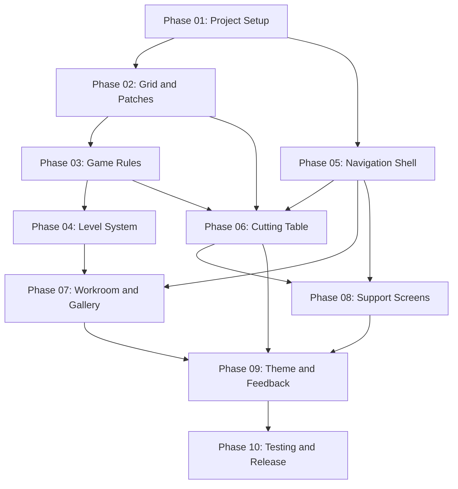

# Patchwork Path — Implementation Plan

Build **Patchwork Path** in ten phases from empty folder to release-ready APK/AAB. Each phase has a self-contained brief in `docs/phases/`. A sub-agent reads only its phase file plus `GDD.md`, `DESIGN_LANGUAGE.md`, and `COMPLIANCE.md`.

**Principle:** Simplest method that works. Dart const level data (no JSON assets). Code-drawn visuals only. `shared_preferences` for stars and unlocks.

---

## Phase list

| # | Name | Summary | Depends on |
|---|------|---------|------------|
| 01 | [Project Setup](phases/phase-01-project-setup.md) | Flutter + Flame scaffold, deps, fonts, folder structure | none |
| 02 | [Grid and Patches](phases/phase-02-grid-and-patches.md) | Render quilt grid, patch shapes, rotation, tap placement | 01 |
| 03 | [Game Rules](phases/phase-03-game-rules.md) | Path validation, thread counter, win/lose, stars logic | 02 |
| 04 | [Level System](phases/phase-04-level-system.md) | 30 level definitions, unlock progression, local save | 03 |
| 05 | [Navigation Shell](phases/phase-05-navigation-shell.md) | Named routes, placeholder screens, app routing | 01 |
| 06 | [Cutting Table](phases/phase-06-cutting-table.md) | Full gameplay screen, HUD, tray, overlays hook-up | 02, 03, 05 |
| 07 | [Workroom and Gallery](phases/phase-07-workroom-and-gallery.md) | Themed main menu and clothesline level select | 04, 05 |
| 08 | [Support Screens](phases/phase-08-support-screens.md) | Splash, pause, bound, tangled, stitch guide, privacy | 05, 06 |
| 09 | [Theme and Feedback](phases/phase-09-theme-and-feedback.md) | Design language polish, animations, haptics, sounds | 06, 07, 08 |
| 10 | [Testing and Release](phases/phase-10-testing-and-release.md) | Widget tests, manual QA checklist, launcher icon, build | 09 |

---

## Dependency graph

**Parallel opportunities:**

- After Phase 01: Phases **02** and **05** can run in parallel.
- After Phase 05: Phase **08** scaffolding can start once Phase **06** has a minimal gameplay route (or use placeholders until 06 lands).

---

## Status table

| Phase | Status | Notes |
|-------|--------|-------|
| 01 — Project Setup | pending | |
| 02 — Grid and Patches | pending | |
| 03 — Game Rules | pending | |
| 04 — Level System | pending | |
| 05 — Navigation Shell | pending | |
| 06 — Cutting Table | pending | |
| 07 — Workroom and Gallery | pending | |
| 08 — Support Screens | pending | |
| 09 — Theme and Feedback | pending | |
| 10 — Testing and Release | pending | |

Sub-agents: mark **in-progress** when starting, **done** when Verify passes; add brief notes in the phase file and update this table.
